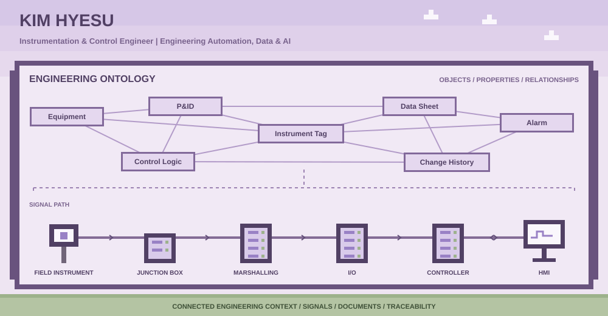

# Hi, I'm Hyesu Kim 👋

**Instrumentation & Control Engineer | Engineering Automation, Data & AI** 
Connecting instrumentation and control engineering with data, AI, and practical automation. 
DL E&C · Plant Business Division | **Jan 2023 — Present**

---

### 🛠️ Core Focus Areas

- **Instrumentation & Control** — Control system architecture, logic design, instrument and package engineering, and HW/SW FAT.
- **Engineering Data & Ontology** — Normalizing design data and connecting tags, equipment, drawings, documents, and alarms through a semantic layer.
- **Applied AI / ML** — Connecting tag-level predictions and validation results with engineer review, change history, and retraining workflows.
- **Design Validation & Automation** — Change impact analysis, layout validation, missing tag checks, and automation of repetitive engineering tasks.

---

### 💻 Tech Stack

**Data & AI Workflow**

**Instrumentation / Control / Plant Design**

**Application Development & Deployment**

---

### 📊 Engineering Impact

~100,000 tags normalized and integrated · ~2,200 instrument data sheets and specification reviews · 130 man-hours saved monthly through Missing Tag Checker automation

---

### 🚀 Featured Projects

#### 🔹 Engineering Ontology & AX Platform

Built an engineering ontology and knowledge graph integrating approximately 100,000 engineering tags using Palantir Foundry, Pipeline Builder, SQL, and Streamlit. Connected instruments, equipment, drawings, documents, and alarms through an Object–Property–Relationship semantic layer, enabling Object 360° views, signal path tracing, and Cause & Effect (C&E) validation. Linked machine learning predictions and engineering validation results with engineer review and change history to support traceable engineering decisions.

#### 🔹 Change Impact Analyzer

Developed a tool to support the review of engineering changes and their potential impact.

#### 🔹 Layout Validation

Developed a validation tool to support engineering layout consistency checks.

#### 🔹 Missing Tag Checker

Developed Missing Tag Checker to identify missing tags and inconsistencies in engineering data, saving **130 man-hours per month** through value engineering improvements.

#### 🔹 AKC Project Instrument Index Agent

Built an AI-assisted desktop tool for preparing Instrument Indexes from chemical and petrochemical plant PFDs. Supports continuous tag numbering across pages, controller-valve serial matching, engineer review of symbols and line sizes, and export to tagged PDFs and the existing Excel index format.

**Python / Tkinter / Vision API / Excel & PDF Automation** 
Prototype with 25 automated tests; live AI extraction accuracy has not yet been evaluated.

#### 🔹 IM Requirement Automation

Developed an IM Requirement automation tool to streamline repetitive engineering tasks. Automation work includes Python-based cable list checks, regex-based P&ID data processing, and internal application deployment through IIS.

---

### 🏗️ Engineering Experience

**DL E&C · Plant Business Division · Instrumentation & Control Engineer** 
Jan 2023 — Present

**Project Experience | Chemical & Petrochemical Plants**

- **S-OIL SHAHEEN Project - Korea** | Feb 2023 - Jul 2024; ongoing FE support and business travel
- **AGCC (Amur Gas Chemical Complex) Project - Russia** | Aug 2024 - Present
- **AKC (Asahi Kasei Corporation) Project - Japan** | Nov 2026 - Present

Control system architecture and logic · Instrument and package engineering · HW/SW FAT and interface verification

**Engineering Data Ontology & AX Platform** · Oct 2025 — Present 
Data and relationship modeling · ML validation and operations workflows · Engineering automation development and deployment

<b>Engineering Data & AX</b>

- Built an engineering ontology based on instrumentation design data to standardize and integrate approximately 100,000 engineering tags, and developed applications using Palantir Foundry, SQL, Streamlit, C#, and JavaScript to automate data-driven engineering workflows.
- Defined Instrument, Equipment, P&ID, Data Sheet, and Alarm as independent entities in an Object–Property–Relationship semantic layer, linking tags with equipment, drawings, documents, alarms, and change history to establish engineering context and data traceability.
- Linked Machine learning predictions and design validation results at tag level with engineer review, change history, and retraining workflows.
- Developed control and instrumentation engineering automation tools, including Change Impact Analyzer, Layout Validation, Missing Tag Checker, IM Requirement Automation, and AKC Project Instrument Index Agent, covering change impact review, layout consistency checks, missing tag detection, engineering requirement workflows, and AI-assisted PFD-to-Instrument Index preparation.

<b>Instrumentation & Control</b>

**Control System Architecture & Logic**

- Engineered and managed control system configurations and architecture.
- Developed and verified interlocks, alarms, permissives, timers, and sequences based on logic diagrams.
- Engineered Signal–Logic–Action structures spanning field instruments, signals, I/O, controllers, and final elements, and verified interface consistency.
- Reviewed schematics, wiring diagrams, location plans, and hook-ups, and coordinated interfaces between systems.

**HW / SW FAT & Logic Validation | Tianjin, China**

- Performed control system HW/SW FAT in collaboration with Chinese vendors and the Russian client.
- Tested software logic in Control Builder against C&E and logic diagrams to verify interlocks, alarms, timers, and sequences.
- Verified field-to-controller signal paths through AI/AO 4–20 mA, DI/DO, 24 VDC, continuity, and I/O hardware loop tests.

**Instrument & Package Engineering**

- Executed MR (Material Requisition), TBE (Technical Bid Evaluation), and PR (Purchase Requisition) activities for approximately 2,200 instrumentation items.
  - Control Valve / On-Off Valve (Ball, Butterfly, Gate, Globe)
  - Flowmeter (Coriolis, Ultrasonic, Magnetic, Orifice Assembly)
  - Pressure Safety Valve (PSV)
  - Level Gauge / Pressure Gauge / Temperature Gauge
- Designed operating conditions, start/stop sequences, permissives, interlocks, and actions for pump and filter packages.
- Reviewed signal lists, I/O, and control interfaces between package equipment and PLC/DCS systems.
- Verified specification, signal, logic, and interface consistency across vendor drawings and engineering documents, and managed design changes.

