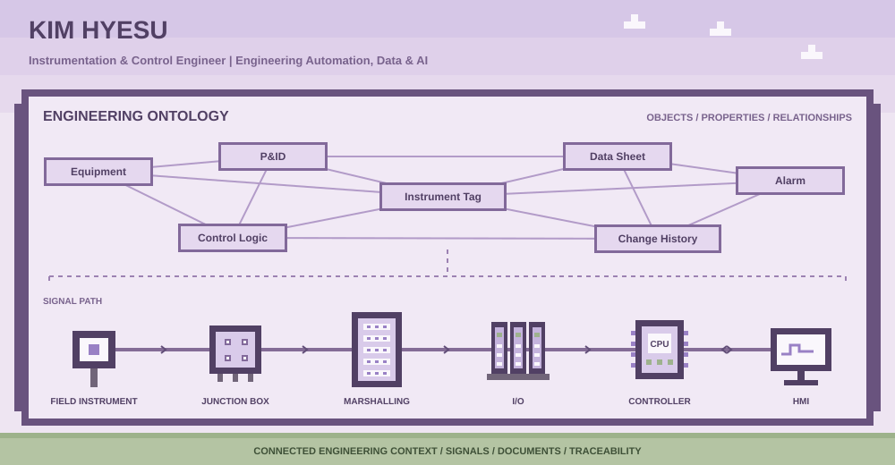
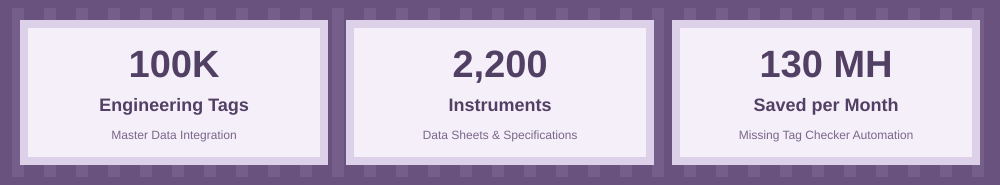

# Hi, I'm Hyesu Kim 👋

**Instrumentation & Control Engineer · Engineering Data & AI** 
계장·제어설계 경험을 바탕으로, 설계 데이터와 AI를 실제 업무에 연결합니다. 
DL이앤씨 · 플랜트사업본부 · 계장설계 엔지니어 / 사원 | **2023.01 — Present**

---

### 🛠️ Core Focus Areas

- **Instrumentation & Control Engineering** — 제어시스템 Architecture·Logic 설계, Instrument·Package Engineering 및 HW/SW FAT.
- **Engineering Data & Ontology** — 설계 데이터를 정규화하고, Tag·설비·도면·문서·Alarm을 관계 모델로 연결.
- **AI / ML in Engineering** — ML 예측과 설계 검증을 담당자 Review·변경 이력·재학습 Workflow로 연결.
- **Design Validation & Automation** — 변경 영향 분석, Layout 검증, Missing Tag 검토 및 반복 설계 업무 자동화.

---

### 💻 Tech Stack

**Data & AI Workflow**

**Instrumentation / Control / Plant Design**

**Application Development & Deployment**

---

### 📊 Engineering Impact

설계 데이터 약 10만 Tag 정규화·통합 / 계기 약 2,200대 Data Sheet 작성·사양 검토 / IM Requirement 자동화로 매월 130 MH 절감

---

### 🚀 Featured Projects

#### 🔹 Engineering Ontology & AX Platform

Palantir Foundry·Pipeline Builder–SQL–Streamlit을 연계해 약 10만 Tag를 Master Data로 통합했습니다. Object–Property–Relationship 기반 Semantic Layer로 Engineering Context를 구성하고, ML 예측·설계 검증·담당자 Review·변경 이력을 하나의 Workflow로 연결했습니다.

#### 🔹 ChangeImpactAnalyzer

설계 변경에 따른 영향 범위를 검토하기 위한 변경 영향 분석 도구를 개발했습니다.

#### 🔹 Layout Validation

설계 Layout의 정합성 확인을 지원하는 검증 도구를 개발했습니다.

#### 🔹 Missing Tag Checker

설계 데이터의 Tag 누락과 불일치 검토를 지원하는 자동화 도구를 개발했습니다.

#### 🔹 IM Requirement Automation

IM Requirement 자동화 Tool을 개발해 반복 업무를 줄이고, VE 개선으로 매월 **130 MH**를 절감했습니다. Python 기반 Cable List 검토 및 P&ID 정규식 데이터 처리 등 설계 자동화 프로그램 개발과 IIS 기반 사내 배포를 수행했습니다.

---

### 🏗️ Engineering Experience

**DL이앤씨 · 플랜트사업본부 · 계장설계 엔지니어 / 사원** 
2023.01 — Present

**Engineering Data 온톨로지 및 AX Platform 구축** · 2025.10 — Present 
데이터 구조·관계 모델 설계 / ML 검증·운영 체계 구축 / 설계 자동화 프로그램 개발·배포

<b>Engineering Data & AX 상세 경력</b>

- Palantir Foundry·Pipeline Builder–SQL–Streamlit 연계로 약 10만 Tag의 설계 데이터를 Master Data로 정규화·통합.
- Instrument, Equipment, P&ID, Data Sheet, Alarm을 독립 Entity로 정의하고 Object–Property–Relationship 기반 Semantic Layer 및 관계 모델 구축.
- Tag 기준으로 설비·도면·문서·Alarm·변경 이력을 연결해 Engineering Context와 데이터 추적성 확보.
- ML 예측·설계 검증 결과를 Tag 단위로 연결하고, 담당자 Review·변경 이력·재학습으로 이어지는 데이터 운영 Workflow 구축.
- Python 기반 Cable List 검토, P&ID 정규식 데이터 처리 등 설계 자동화 프로그램 개발 및 IIS 기반 사내 배포.
- IM Requirement 자동화 Tool 개발 및 VE 개선으로 매월 130 MH 절감.

**S-OIL SHAHEEN · Amur Gas Chemical Complex (AGCC)** · 2023.01 — Present 
제어시스템 Architecture·Logic 설계 / Instrument·Package 설계 / HW·SW FAT 및 Interface 검증

<b>Instrumentation & Control 상세 경력</b>

**Control System Architecture & Logic**

- System Configuration 및 제어시스템 Architecture 설계·관리.
- Logic Diagram 기반 Interlock, Alarm, Permissive, Timer, Sequence 설계·검증.
- Field Instrument–Signal–I/O–Controller–Final Element의 Signal–Logic–Action 구조 설계 및 Interface 정합성 검토.
- Schematic, Wiring Diagram, Location Plan, Hook-up 등 설계도서 검토 및 시스템 간 Interface 관리.

**HW / SW FAT & Logic Validation**

- 중국 벤더·러시아 발주처와 협업하여 제어시스템 HW/SW FAT 수행.
- Control Builder 기반 SW 로직 테스트로 C&E·Logic Diagram 대비 Interlock, Alarm, Timer, Sequence 정상 동작 검증.
- AI/AO 4–20 mA, DI/DO, 24 VDC, Continuity 등 I/O·HW 루프 테스트로 Field Signal부터 Controller까지 신호 경로 검증.

**Instrument & Package Engineering**

- 온도·압력·유량·레벨 계기 약 2,200대 Data Sheet 작성 및 Process·설비 조건에 따른 사양 검토.
- Pump/Filter Package 운전 조건, Start/Stop Sequence, Permissive, Interlock 및 Action 설계.
- Package Equipment와 PLC/DCS 간 Signal List, I/O 및 제어 Interface 검토.
- 벤더 도면·설계도서 간 사양, Signal, Logic, Interface 정합성 검증 및 설계 변경 관리.

